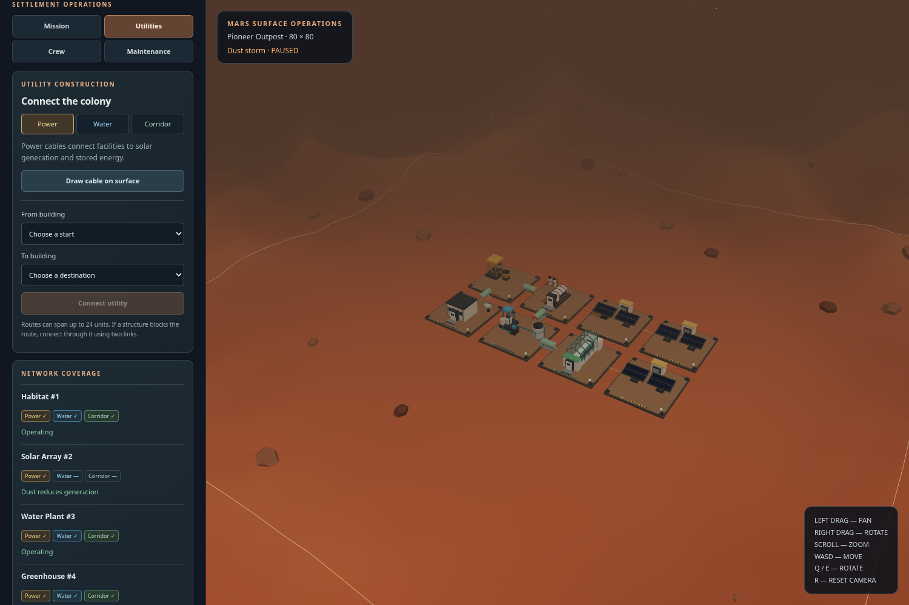

# Mars: The New Frontier

A browser-based Mars colony builder built with React, Three.js, and React Three Fiber. Build a settlement, connect its utilities, staff its facilities, prepare for dust storms, and complete an eight-stage campaign toward self-sufficiency.



## Run locally

Use a current Node.js LTS release (Node 22.12+ or Node 24 recommended).

```sh
npm ci
npm run dev
```

Open the local URL printed by Vite. Start **Survival** for the campaign or **Sandbox** for free construction. New colonies start paused. **Advance one sol** steps the simulation; **Resume simulation** advances it every five seconds.

## The colony loop

1. Place a solar array and connect it to the starting habitat with a power cable.
2. Power a water plant, then pipe water to the habitat and a powered greenhouse.
3. Link workplaces to the habitat with pressurized corridors and assign workers.
4. Build mining and research facilities, improve equipment, and fund maintenance.
5. Prepare reserves for forecast storms, support arriving colonists, and achieve sustained self-sufficiency.

Open **Operations** for **Mission**, **Utilities**, **Crew**, and **Maintenance**. The mission panel explains the current objective and its reward. Rewards are explicit and can be claimed once. The construction inspector compares current and next-level output and demand.

See [the player guide](docs/gameplay.md) for detailed instructions.

## Implemented systems

- **Construction:** six procedural building families, 80 supported upgrade levels, fixed construction plots, collision and route checks, live placement feedback, and spatial ice/ore yields.
- **Utilities:** separate power, water, and corridor graphs; visible terrain-following routes; per-link construction costs; a 24-unit link limit; and connected/offline facility status. Routes cannot pass through a third building.
- **Energy:** generation, demand, and stored energy are tracked per connected power component. An isolated solar field cannot power a different grid through the colony-wide resource counter.
- **Survival:** food, water, serviced housing, health, and morale. Connected workers improve automated base output. Healthcare and recreation consume displayed upkeep supplies.
- **Mars hazards:** a deterministic weather cycle and three-sol forecast, reduced solar generation during dust events, equipment wear, paid preparation, and repairs. A facility at 15% condition or below stops operating and relaying utilities.
- **Campaign:** first power, water, agriculture, jobs, industry, research, storm resilience, and three supported sols with at least eight colonists. Arrivals require stable essential services, health, morale, and housing capacity.
- **Sandbox:** free construction and upgrades. Survival can be enabled separately; with it disabled, simulation does not consume resources or wear equipment.
- **Persistence:** local autosave, validated version-3 state, safe version-2 migration, and JSON backup export. The original legacy save is retained before migration when browser storage is available.

Shortfalls reduce health and morale and stop growth; the current survival mode allows recovery rather than permanent colonist deaths.

| Building | Levels | Main function |
| --- | --- | --- |
| Habitat | 1–15 | Residential capacity and corridor origin |
| Solar array | 1–10 | Electricity generation |
| Water plant | 1–15 | Water extraction and pipe supply |
| Greenhouse | 1–10 | Food production using water and electricity |
| Mining facility | 1–15 | Metal extraction affected by ore yield |
| Research centre | 1–15 | Research points and technology development |

## Controls

- Choose a building in **Build**, then click a valid plot.
- In **Operations → Utilities**, use endpoint selectors or enable the surface tool and click two buildings.
- **Escape** cancels construction or utility drawing.
- Left drag pans; right drag rotates; scroll zooms.
- WASD moves the camera; Q/E rotates; R resets it. Camera shortcuts ignore form inputs.

The interface adapts to narrow screens by placing the map above a scrollable operations panel.

## Saves

Saves live in this browser's local storage under the retained key `mars-new-frontier-save-v2`; the payload is now version 3. Existing version-2 colonies retain their buildings, IDs, levels, resources, and technologies, receive nearby legacy utility connections, and load paused for review. Their original data is stored at the same key plus `-legacy-backup` when storage permits.

Version-3 saves include connections, condition, worker assignments, local battery reserves, policies, and campaign progress. **Export colony backup** downloads a JSON snapshot. Saves are local to the browser and are not cloud-synchronized.

## Development and validation

```sh
npm run build
npm run lint
npm run test:unit
npx playwright install chromium
npm test
```

With an installed system Chromium:

```sh
CHROMIUM_PATH=/usr/bin/chromium npm test
```

The unit suite covers graph reachability, source/relay failure, link validation, legacy migration, grid energy isolation, transactional actions, worker limits, policy upkeep, weather protection, repairs, and a complete legal campaign run. Browser tests cover real map construction and cable drawing, utility controls, assignments, policies, repairs, rewards, mobile layout, save reloads, and geometry progression and bounds across all 80 model levels.

Open `/tests/model-review.html` on the development server to inspect models and animations. This review entry is not part of the production build. See [the architecture guide](docs/architecture.md) for the model structure and rendered overview.

The dormant 2D prototype and backup world file remain in the repository; the active entry is `src/main.jsx` → `MarsPreview.jsx` → `MarsWorld.jsx`. Existing lint warnings in those older files are separate from the active gameplay implementation. Rendering has been checked with Chromium; broad hardware performance and touch-camera testing remain future validation work.

## License

[MIT](LICENSE)
