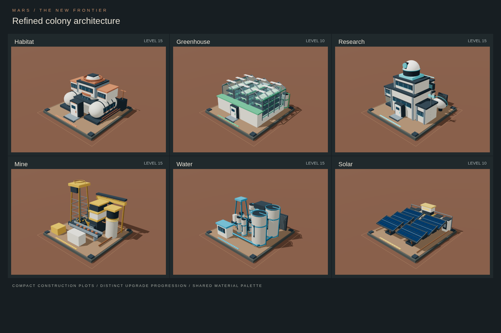

# Refined colony architecture

The six procedural React Three Fiber models now share a ceramic, steel, and Martian-dust palette. Each uses a 6.6-unit foundation inside the existing 7.5-unit construction plot. Distinct silhouettes, utility layouts, and architectural milestones make building types and upgrades recognizable without shrinking entire campuses.



| Building | Levels | Architectural progression |
| --- | --- | --- |
| Habitat | 1–15 | Pressure capsule → connected living pods → communal hub → two-storey residence → terraced residential crown |
| Greenhouse | 1–10 | Growing chamber → paired chambers → stacked hydroponics → three-bay agricultural block with climate and recycling equipment |
| Research | 1–15 | Field laboratory → connected analysis wing → two-storey institute → specialized modules and rooftop observatory |
| Mining | 1–15 | Extraction headframe and hopper → conveyor and crusher → storage and processing hall → automated loading gantry |
| Water | 1–15 | Wellhead and pump → filters and treatment building → paired reservoirs → redundant treatment and distribution equipment |
| Solar | 1–10 | Two panel tables → four tables and storage → six tracking tables → integrated conversion, batteries, and grid control |

Every supported level changes the architecture or installed equipment, as well as its foundation's upgrade markers. Water, mining, and research now have distinct geometry through level 15. Solar and greenhouse retain their existing ten-level limits.

## Integration

Existing component filenames, default exports, and the `level` prop are preserved. The game catalogue, costs, production, resource simulation, building identifiers, and version-2 save format are unchanged. Models additionally accept `animated={false}` for static review.

Shared components live in `src/components/buildings/shared/`. Repeated photovoltaic cells, crops, and ore use instanced geometry. Moving parts have bounded travel; the mine conveyor loops within its tray, the crane stays on its rail, the research dish scans slowly, and advanced solar tables tilt within their support clearances.

`CompactBuildingModel` is shared by placed buildings, construction previews, and the review page. Its scale is capped at 1 and its fitted width/depth at `plotSize - 0.6`. The old multiplier that enlarged large models beyond the reserved plot has been removed. The models' fixed foundations keep their placement centers and apparent scale consistent across upgrades.

## Review locally

```sh
npm ci
npm run dev
```

Open `/tests/model-review.html` on the local Vite server to select any building and level, or enable its animation. This is a development review entry and is not included in the normal production build.

## Validation

```sh
npm run build
npm run lint
npx playwright install chromium
npm run test:models
```

For an existing system Chromium, use `CHROMIUM_PATH=/usr/bin/chromium npm run test:models` instead of installing another browser.

The browser checks cover all 80 supported building levels, finite geometry, plot containment, ground contact, per-level geometry changes, bounded mesh/triangle counts, multiple animation poses, a deliberately oversized/off-center fitting fixture, and loading an existing version-2 save containing all six final-stage buildings.

The count thresholds are regression guards, not a claim of frame-rate performance on all hardware. The production build retains Vite's large-bundle warning; the repository also has existing lint warnings in the game and backup files.
